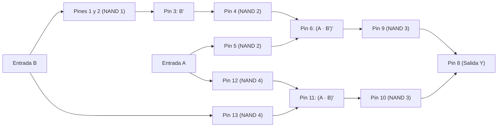

# Punto 1: Análisis, Reducción y Tabla de Verdad del Circuito con CI 7400

## 1. Enunciado
Construir la tabla de verdad y realizar el montaje en el protoboard comparando los resultados obtenidos de manera teórica y práctica para el circuito mostrado en la guía (basado en el circuito integrado **7400**).

---

## 2. Identificación del Circuito Integrado (7400 / 74LS00)
El circuito integrado **7400** contiene **4 compuertas lógicas NAND de 2 entradas** en un encapsulado DIP de 14 pines:
* **Alimentación:** Pin 14 = $V_{CC}$ ($+5\text{ V}$), Pin 7 = $\text{GND}$ ($0\text{ V}$).
* **Compuerta NAND 1:** Entradas en **Pin 1** y **Pin 2** $\rightarrow$ Salida en **Pin 3**.
* **Compuerta NAND 2:** Entradas en **Pin 4** y **Pin 5** $\rightarrow$ Salida en **Pin 6**.
* **Compuerta NAND 3:** Entradas en **Pin 9** y **Pin 10** $\rightarrow$ Salida en **Pin 8**.
* **Compuerta NAND 4:** Entradas en **Pin 12** y **Pin 13** $\rightarrow$ Salida en **Pin 11**.

---

## 3. Seguimiento de Conexiones (Ruteo de Pines)
A partir del diagrama esquemático se identifican las siguientes conexiones:

1. **Entrada $A$ (Interruptor `[A]`):**
   * Conmuta entre $+5\text{ V}$ ($1$ lógico) y $\text{GND}$ ($0$ lógico).
   * Se conecta directamente al **Pin 5** y al **Pin 12**.
2. **Entrada $B$ (Interruptor `[B]`):**
   * Conmuta entre $+5\text{ V}$ ($1$ lógico) y $\text{GND}$ ($0$ lógico).
   * Se conecta a los **Pines 1 y 2** (unidos entre sí) y al **Pin 13**.
3. **Etapa 1 — Compuerta NAND 1 (Pines 1, 2 $\rightarrow$ Pin 3):**
   * $\text{Pin 1} = B$, $\text{Pin 2} = B$.
   * La compuerta opera como un inversor (NOT):
     $$S_1 = \text{Pin 3} = \overline{B \cdot B} = \overline{B}$$
   * Esta salida ($\text{Pin 3}$) se puentea hacia la entrada **Pin 4**.
4. **Etapa 2 — Compuerta NAND 2 (Pines 4, 5 $\rightarrow$ Pin 6):**
   * $\text{Pin 4} = \overline{B}$, $\text{Pin 5} = A$.
   * Su salida en el **Pin 6** es:
     $$S_2 = \text{Pin 6} = \overline{A \cdot \overline{B}}$$
   * Esta salida ($\text{Pin 6}$) se conecta a la entrada **Pin 9**.
5. **Etapa 3 — Compuerta NAND 4 (Pines 12, 13 $\rightarrow$ Pin 11):**
   * $\text{Pin 12} = A$, $\text{Pin 13} = B$.
   * Su salida en el **Pin 11** es:
     $$S_4 = \text{Pin 11} = \overline{A \cdot B}$$
   * Esta salida ($\text{Pin 11}$) se puentea directamente a la entrada **Pin 10**.
6. **Etapa Final — Compuerta NAND 3 (Pines 9, 10 $\rightarrow$ Pin 8 / Salida $Y$):**
   * $\text{Pin 9} = \overline{A \cdot \overline{B}}$, $\text{Pin 10} = \overline{A \cdot B}$.
   * Su salida en el **Pin 8** corresponde a la salida $Y$ (conectada al ánodo del LED en serie con la resistencia de $150\ \Omega$ a tierra):
     $$Y = \text{Pin 8} = \overline{\left(\overline{A \cdot \overline{B}}\right) \cdot \left(\overline{A \cdot B}\right)}$$

---

## 4. Diagrama Lógico Equivalente

---

## 5. Simplificación mediante Álgebra de Boole
Partiendo de la expresión obtenida en el **Pin 8**:

$$Y = \overline{\left(\overline{A \cdot \overline{B}}\right) \cdot \left(\overline{A \cdot B}\right)}$$

Aplicando la **Ley de De Morgan** ($\overline{X \cdot Z} = \overline{X} + \overline{Z}$) y la propiedad de doble negación ($\overline{\overline{X}} = X$):

$$Y = \overline{\left(\overline{A \cdot \overline{B}}\right)} + \overline{\left(\overline{A \cdot B}\right)}$$

$$Y = (A \cdot \overline{B}) + (A \cdot B)$$

Sacando factor común $A$:

$$Y = A \cdot (\overline{B} + B)$$

Por el postulado del complemento ($\overline{B} + B = 1$) y de identidad ($A \cdot 1 = A$):

$$\mathbf{Y = A}$$

> [!IMPORTANT]
> **Conclusión de la reducción:** Aunque el circuito utiliza las 4 compuertas NAND del integrado 7400, la función lógica completa se reduce exactamente a **$Y = A$**. Es decir, el estado del LED depende únicamente de la entrada $A$, siendo independiente del valor de $B$.

---

## 6. Tabla de Verdad
Se incluyen los estados lógicos de los pines intermedios para facilitar la verificación con punta lógica o multímetro en el protoboard:

| Entrada $A$ (Pines 5, 12) | Entrada $B$ (Pines 1, 2, 13) | Pin 3 $\overline{B}$ | Pin 6 $\overline{A \cdot \overline{B}}$ | Pin 11 $\overline{A \cdot B}$ | Salida $Y$ (Pin 8) $A\overline{B} + AB = A$ | Estado Teórico del LED |
| :---: | :---: | :---: | :---: | :---: | :---: | :---: |
| **0** | **0** | 1 | 1 | 1 | **0** | Apagado |
| **0** | **1** | 0 | 1 | 1 | **0** | Apagado |
| **1** | **0** | 1 | 0 | 1 | **1** | Encendido |
| **1** | **1** | 0 | 1 | 0 | **1** | Encendido |

---

## 7. Notas de Acondicionamiento para el Montaje Práctico e Informe IEEE
1. **Resistencia Pull-Down / Conmutación de Entradas:**
   * En el diagrama los interruptores `[A]` y `[B]` son de tipo SPDT (conmutan directamente entre $+5\text{ V}$ y $\text{GND}$), lo cual garantiza niveles lógicos definidos en todo momento. Si en el protoboard se usan pulsadores o DIP switches simples (SPST), se deben colocar resistencias *pull-down* (de $1\text{ k}\Omega$ a $4.7\text{ k}\Omega$ en TTL, o $10\text{ k}\Omega$ en CMOS) a tierra para evitar entradas flotantes (en TTL una entrada al aire es interpretada como un `1` lógico).
2. **Acondicionamiento de Corriente en la Salida:**
   * Como indica la nota final de la guía, las compuertas TTL (**74LS00**) no están diseñadas para suministrar (*source*) altas corrientes en estado alto ($I_{OH(\text{máx})} \approx 0.4\text{ mA}$). Conectar un LED directo con $150\ \Omega$ a tierra exige alrededor de $10\text{ mA}$, lo que cae el voltaje de salida del Pin 8 o sobrecarga la compuerta.
   * **Acondicionamiento recomendado:** Utilizar un transistor NPN (por ejemplo, **2N2222** o **2N3904**) como etapa *driver*:
     * Pin 8 $\rightarrow$ Resistencia de base ($R_B = 1\text{ k}\Omega$ a $4.7\text{ k}\Omega$) $\rightarrow$ Base del NPN.
     * Emisor del NPN $\rightarrow$ $\text{GND}$.
     * $+5\text{ V}$ $\rightarrow$ Resistencia de $150\ \Omega$ (o $220\ \Omega$) $\rightarrow$ Ánodo del LED $\rightarrow$ Cátodo del LED $\rightarrow$ Colector del NPN.
