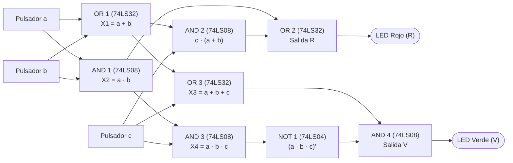

# Punto 2: Diseño del Circuito de Control de Dos LEDs (Rojo y Verde) con Tres Pulsadores

## 1. Enunciado
Diseñar el circuito de encendido de dos diodos LED (rojo y verde), mediante tres pulsadores $a$, $b$ y $c$, que cumpla las siguientes condiciones de funcionamiento:
* **a)** Si se pulsan los tres pulsadores, el diodo LED rojo se activa.
* **b)** Si se pulsan dos pulsadores, el diodo LED rojo se activa, y el diodo verde también lo hará.
* **c)** Si solo se pulsa un pulsador, el diodo rojo no se activa, pero sí se enciende el diodo verde.
* **d)** Si no se pulsa ningún pulsador, los diodos están apagados.

El circuito debe ser simulado en **Quartus II** y montado en el protoboard; si es posible debe ser reducido a su más mínima expresión, realizando la comparación de los resultados obtenidos (parte teórica, simulación y parte práctica).

---

## 2. Definición de Variables
* **Entradas (Pulsadores):** $a, b, c \in \{0, 1\}$
  * `0` lógico ($0\text{ V}$): Pulsador sin presionar.
  * `1` lógico ($+5\text{ V}$): Pulsador presionado.
* **Salidas (Diodos LED):**
  * **$R$ (LED Rojo):** `1` = Encendido, `0` = Apagado.
  * **$V$ (LED Verde):** `1` = Encendido, `0` = Apagado.

---

## 3. Tabla de Verdad

| Minitérmino | $a$ | $b$ | $c$ | Cantidad de pulsadores activos | Condición aplicada | LED Rojo ($R$) | LED Verde ($V$) |
| :---: | :---: | :---: | :---: | :---: | :---: | :---: | :---: |
| $m_0$ | 0 | 0 | 0 | Ninguno (0) | d) | **0** | **0** |
| $m_1$ | 0 | 0 | 1 | Uno (1) | c) | **0** | **1** |
| $m_2$ | 0 | 1 | 0 | Uno (1) | c) | **0** | **1** |
| $m_3$ | 0 | 1 | 1 | Dos (2) | b) | **1** | **1** |
| $m_4$ | 1 | 0 | 0 | Uno (1) | c) | **0** | **1** |
| $m_5$ | 1 | 0 | 1 | Dos (2) | b) | **1** | **1** |
| $m_6$ | 1 | 1 | 0 | Dos (2) | b) | **1** | **1** |
| $m_7$ | 1 | 1 | 1 | Tres (3) | a) | **1** | **0** |

### Expresiones Canónicas (Suma de Minitérminos)
* **LED Rojo ($R$):**
  $$R(a,b,c) = \sum m(3, 5, 6, 7) = \overline{a}bc + a\overline{b}c + ab\overline{c} + abc$$
* **LED Verde ($V$):**
  $$V(a,b,c) = \sum m(1, 2, 3, 4, 5, 6) = \overline{a}\overline{b}c + \overline{a}b\overline{c} + \overline{a}bc + a\overline{b}\overline{c} + a\overline{b}c + ab\overline{c}$$
  *(En forma de Producto de Maxitérminos: $V(a,b,c) = \prod M(0, 7)$).*

---

## 4. Simplificación por Mapas de Karnaugh y Álgebra de Boole

### 4.1. Simplificación para el LED Rojo ($R$)

| $a \backslash bc$ | **00** | **01** | **11** | **10** |
| :---: | :---: | :---: | :---: | :---: |
| **0** | 0 | 0 | **1** ($m_3$) | 0 |
| **1** | 0 | **1** ($m_5$) | **1** ($m_7$) | **1** ($m_6$) |

Agrupando los unos en pares adyacentes:
1. Grupo $(m_3, m_7) \rightarrow bc$
2. Grupo $(m_5, m_7) \rightarrow ac$
3. Grupo $(m_6, m_7) \rightarrow ab$

**Expresión mínima en Suma de Productos (SOP):**
$$R = ab + ac + bc$$

**Factorización adicional (para usar menos compuertas):**
$$\mathbf{R = ab + c(a + b)}$$

---

### 4.2. Simplificación para el LED Verde ($V$)

| $a \backslash bc$ | **00** | **01** | **11** | **10** |
| :---: | :---: | :---: | :---: | :---: |
| **0** | **0** ($m_0$) | **1** ($m_1$) | **1** ($m_3$) | **1** ($m_2$) |
| **1** | **1** ($m_4$) | **1** ($m_5$) | **0** ($m_7$) | **1** ($m_6$) |

#### Método A: Suma de Productos (SOP — Agrupando los `1`s)
Se forman tres pares que cubren los seis minitérminos:
1. Grupo $(m_1, m_3) \rightarrow \overline{a}c$
2. Grupo $(m_2, m_6) \rightarrow b\overline{c}$
3. Grupo $(m_4, m_5) \rightarrow a\overline{b}$

$$V_{\text{SOP}} = a\overline{b} + b\overline{c} + \overline{a}c \quad \text{(o su equivalente simétrica: } \overline{a}b + \overline{b}c + a\overline{c}\text{)}$$

#### Método B: Producto de Sumas / Factorización por Ceros (Óptima en Compuertas)
Observando el mapa de Karnaugh, $V$ solo vale `0` en dos casillas: $m_0 (000)$ y $m_7 (111)$.
Por lo tanto, la función negada $\overline{V}$ es:
$$\overline{V} = \overline{a}\overline{b}\overline{c} + abc$$

Negando ambos lados y aplicando las Leyes de De Morgan:
$$V = \overline{\overline{a}\overline{b}\overline{c} + abc} = (a + b + c) \cdot \overline{(abc)}$$

$$\mathbf{V = (a + b + c) \cdot (\overline{a} + \overline{b} + \overline{c}) = (a + b + c) \cdot \overline{(abc)}}$$

#### Método C: Reducción con Compuertas XOR
Dado que $V = 1$ siempre que al menos dos entradas sean diferentes entre sí:
$$\mathbf{V = (a \oplus b) + (b \oplus c)}$$
Y para el LED rojo:
$$\mathbf{R = ab + c(a \oplus b)}$$

---

## 5. Circuito Reducido a su Mínima Expresión (Reutilizando Subexpresiones)

Si compartimos los bloques intermedios $(a + b)$ y $(a \cdot b)$ entre las ecuaciones de $R$ y $V$:
1. $X_1 = a + b$
2. $X_2 = a \cdot b$
3. $\mathbf{R = X_2 + c \cdot X_1}$
4. $X_3 = X_1 + c = a + b + c$
5. $X_4 = X_2 \cdot c = a \cdot b \cdot c$
6. $\mathbf{V = X_3 \cdot \overline{X_4}}$

> [!TIP]
> **Ahorro de circuitos integrados para el protoboard:**
> Con esta factorización, **todo el circuito completo** (ambos LEDs) se arma con solo **3 circuitos integrados básicos de 2 entradas**:
> * **1x CI 74LS32** (usa 3 de sus 4 compuertas OR de 2 entradas).
> * **1x CI 74LS08** (usa las 4 compuertas AND de 2 entradas).
> * **1x CI 74LS04** (usa 1 de sus 6 inversores NOT).
>
> *(Alternativa con XOR: usando **1x 74LS86**, **1x 74LS08** y **1x 74LS32** también se implementa completo con solo 5 compuertas en total).*

### Diagrama Esquemático de Compuertas (Reutilización Óptima)



---

## 6. Mapeo de Pines Sugerido para el Protoboard

| Circuito Integrado | Compuerta | Pines de Entrada | Pin de Salida | Señal en el Circuito |
| :--- | :--- | :---: | :---: | :--- |
| **74LS32 (OR)** | Compuerta 1 | Pin 1 ($a$), Pin 2 ($b$) | **Pin 3** | $X_1 = a + b$ |
| **74LS32 (OR)** | Compuerta 2 | Pin 4 ($X_2$), Pin 5 ($c \cdot X_1$) | **Pin 6** | **Salida $R$ (LED Rojo)** |
| **74LS32 (OR)** | Compuerta 3 | Pin 9 ($X_1$), Pin 10 ($c$) | **Pin 8** | $X_3 = a + b + c$ |
| **74LS08 (AND)** | Compuerta 1 | Pin 1 ($a$), Pin 2 ($b$) | **Pin 3** | $X_2 = a \cdot b$ |
| **74LS08 (AND)** | Compuerta 2 | Pin 4 ($X_1$), Pin 5 ($c$) | **Pin 6** | $c \cdot (a + b)$ |
| **74LS08 (AND)** | Compuerta 3 | Pin 9 ($X_2$), Pin 10 ($c$) | **Pin 8** | $X_4 = a \cdot b \cdot c$ |
| **74LS08 (AND)** | Compuerta 4 | Pin 12 ($X_3$), Pin 13 ($\overline{X_4}$) | **Pin 11** | **Salida $V$ (LED Verde)** |
| **74LS04 (NOT)** | Inversor 1 | Pin 1 ($X_4$) | **Pin 2** | $\overline{X_4} = \overline{abc}$ |

*(En todos los integrados: **Pin 14** a $+5\text{ V}$ y **Pin 7** a $\text{GND}$).*

---

## 7. Implementación para Simulación en Quartus II (VHDL)

Si además del diagrama de bloques (`.bdf`) deseas simularlo mediante código VHDL en Quartus II:

```vhdl
library IEEE;
use IEEE.STD_LOGIC_1164.ALL;

entity punto2_leds is
    Port (
        a : in  STD_LOGIC;
        b : in  STD_LOGIC;
        c : in  STD_LOGIC;
        R : out STD_LOGIC; -- LED Rojo
        V : out STD_LOGIC  -- LED Verde
    );
end punto2_leds;

architecture Behavioral of punto2_leds is
begin
    -- Expresión mínima para el LED Rojo:
    R <= (a and b) or (c and (a or b));

    -- Expresión mínima para el LED Verde:
    V <= (a or b or c) and not (a and b and c);
end Behavioral;
```

---

## 8. Acondicionamiento Físico (Entradas y Salidas)
1. **Pulsadores $a, b, c$ (Configuración Pull-Down):**
   * Conectar un terminal de cada pulsador a $+5\text{ V}$.
   * El otro terminal va al pin de entrada de las compuertas y, simultáneamente, a una resistencia de $1\text{ k}\Omega$ (o $2.2\text{ k}\Omega$) hacia $\text{GND}$. Así se asegura un `0` lógico estable cuando no se pulsa y un `1` lógico ($+5\text{ V}$) al presionar.
2. **Etapa de Potencia para los LEDs Rojo y Verde:**
   * Desde la salida $R$ (**Pin 6 del 74LS32**) y la salida $V$ (**Pin 11 del 74LS08**), conectar una resistencia de base de $2.2\text{ k}\Omega$ a la base de un transistor **2N2222** (uno para cada LED).
   * Emisor a $\text{GND}$, y en el colector el cátodo del LED respectivo con su resistencia limitadora de $220\ \Omega$ conectada a $+5\text{ V}$.
