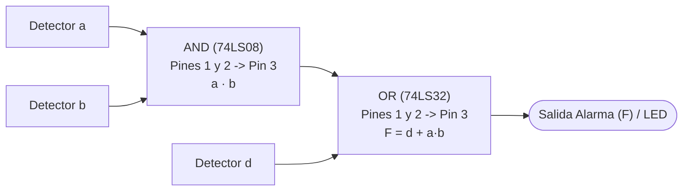

# Punto 3: Sistema de Alarma de Cuatro Detectores con Condiciones de Indiferencia (*Don't Care*)

## 1. Enunciado
Un sistema de alarma está constituido por cuatro detectores denominados $a$, $b$, $c$ y $d$; el sistema debe activarse cuando se activen tres o cuatro detectores, si solo lo hacen dos detectores es indiferente la activación o no del sistema. El sistema nunca debe activarse si se dispara un solo detector o ninguno. Por razones de seguridad el sistema se deberá activar si $a = 0$, $b = 0$, $c = 0$ y $d = 1$.

El circuito debe ser simulado en **Quartus II**; si es posible debe ser reducido a su mínima expresión, y comparar los resultados teóricos y prácticos obtenidos.

---

## 2. Definición de Variables y Condiciones de Diseño
* **Entradas (Detectores):** $a, b, c, d \in \{0, 1\}$
  * `0`: Detector inactivo.
  * `1`: Detector activado.
* **Salida:** $F \in \{0, 1, X\}$ (Alarma)
  * `1`: Alarma activada.
  * `0`: Alarma desactivada.
  * `X`: Estado indiferente (*Don't Care*).

### Reglas de Funcionamiento:
1. **3 o 4 detectores activos:** $F = 1 \rightarrow m_7, m_{11}, m_{13}, m_{14}, m_{15}$.
2. **2 detectores activos:** $F = X$ (indiferente) $\rightarrow m_3, m_5, m_6, m_9, m_{10}, m_{12}$.
3. **0 o 1 detector activo:** $F = 0 \rightarrow m_0, m_2, m_4, m_8$.
4. **Excepción de seguridad ($a=0, b=0, c=0, d=1$):** $F = 1 \rightarrow m_1$.

---

## 3. Tabla de Verdad

| Minitérmino | $a$ | $b$ | $c$ | $d$ | Detectores activos | Regla aplicada | Salida Alarma ($F$) | Salida con $F = d + ab$ |
| :---: | :---: | :---: | :---: | :---: | :---: | :--- | :---: | :---: |
| $m_0$ | 0 | 0 | 0 | 0 | 0 | Ningún detector | **0** | 0 |
| $m_1$ | 0 | 0 | 0 | 1 | 1 | **Seguridad ($0001$)** | **1** | 1 |
| $m_2$ | 0 | 0 | 1 | 0 | 1 | 1 solo detector | **0** | 0 |
| $m_3$ | 0 | 0 | 1 | 1 | 2 | Indiferente (2 det.) | **X** | 1 |
| $m_4$ | 0 | 1 | 0 | 0 | 1 | 1 solo detector | **0** | 0 |
| $m_5$ | 0 | 1 | 0 | 1 | 2 | Indiferente (2 det.) | **X** | 1 |
| $m_6$ | 0 | 1 | 1 | 0 | 2 | Indiferente (2 det.) | **X** | 0 |
| $m_7$ | 0 | 1 | 1 | 1 | 3 | 3 detectores | **1** | 1 |
| $m_8$ | 1 | 0 | 0 | 0 | 1 | 1 solo detector | **0** | 0 |
| $m_9$ | 1 | 0 | 0 | 1 | 2 | Indiferente (2 det.) | **X** | 1 |
| $m_{10}$ | 1 | 0 | 1 | 0 | 2 | Indiferente (2 det.) | **X** | 0 |
| $m_{11}$ | 1 | 0 | 1 | 1 | 3 | 3 detectores | **1** | 1 |
| $m_{12}$ | 1 | 1 | 0 | 0 | 2 | Indiferente (2 det.) | **X** | 1 |
| $m_{13}$ | 1 | 1 | 0 | 1 | 3 | 3 detectores | **1** | 1 |
| $m_{14}$ | 1 | 1 | 1 | 0 | 3 | 3 detectores | **1** | 1 |
| $m_{15}$ | 1 | 1 | 1 | 1 | 4 | 4 detectores | **1** | 1 |

### Expresión Canónica:
$$F(a, b, c, d) = \sum m(1, 7, 11, 13, 14, 15) + \sum d(3, 5, 6, 9, 10, 12)$$

---

## 4. Simplificación por Mapa de Karnaugh

Ubicando los `1`s, `0`s y condiciones indiferentes `X` en el mapa de 4 variables:

| $ab \backslash cd$ | **00** | **01** | **11** | **10** |
| :---: | :---: | :---: | :---: | :---: |
| **00** | **0** ($m_0$) | **1** ($m_1$) | **X** ($m_3$) | **0** ($m_2$) |
| **01** | **0** ($m_4$) | **X** ($m_5$) | **1** ($m_7$) | **X** ($m_6$) |
| **11** | **X** ($m_{12}$) | **1** ($m_{13}$) | **1** ($m_{15}$) | **1** ($m_{14}$) |
| **10** | **0** ($m_8$) | **X** ($m_9$) | **1** ($m_{11}$) | **X** ($m_{10}$) |

### Agrupaciones en Suma de Productos (SOP):
1. **Octeto (Grupo de 8 casillas):**
   * Las dos columnas centrales completas ($cd = 01$ y $cd = 11$), conformadas por $\{m_1, m_3, m_5, m_7, m_{13}, m_{15}, m_9, m_{11}\}$, contienen únicamente `1`s y `X`s.
   * Este octeto cubre de inmediato los minitérminos $m_1, m_7, m_{11}, m_{13}, m_{15}$ y se reduce a:
     $$\text{Grupo 1} = \mathbf{d}$$
2. **Cuarteto (Grupo de 4 casillas) para cubrir $m_{14}$:**
   * El único `1` pendiente por cubrir es **$m_{14} (1110)$**.
   * Aprovechando las condiciones `X`, existen **tres cuartetos equivalentes** de igual costo mínimo que cubren $m_{14}$:
     * **Opción A (Fila $ab = 11$ completa):** $\{m_{12}, m_{13}, m_{15}, m_{14}\} \rightarrow \mathbf{ab}$
     * **Opción B (Subcuadrado $b=1, c=1$):** $\{m_6, m_7, m_{14}, m_{15}\} \rightarrow \mathbf{bc}$
     * **Opción C (Subcuadrado $a=1, c=1$):** $\{m_{10}, m_{11}, m_{14}, m_{15}\} \rightarrow \mathbf{ac}$

### Expresión Mínima Obtenida:
$$\mathbf{F = d + ab}$$
*(También son igualmente válidas y mínimas: **$F = d + bc$** o **$F = d + ac$**).*

---

### Verificación por Producto de Sumas (POS — Agrupando los `0`s)
Agrupando los cuatro `0`s del mapa ($m_0, m_2, m_4, m_8$) junto con las `X` de la columna $cd = 10$:
* **Cuarteto de ceros 1:** $\{m_0, m_2, m_4, m_6\} \rightarrow a = 0, d = 0 \implies \text{Maxitérmino } (a + d)$
* **Cuarteto de ceros 2:** $\{m_0, m_2, m_8, m_{10}\} \rightarrow b = 0, d = 0 \implies \text{Maxitérmino } (b + d)$

Multiplicando ambos maxitérminos y aplicando la propiedad distributiva:
$$F_{\text{POS}} = (a + d)(b + d) = d + ab$$
Se comprueba que tanto por SOP como por POS se llega exactamente a la misma expresión mínima.

> [!NOTE]
> **Comparación para el Informe IEEE (Con vs. Sin condiciones *Don't Care*):**
> * **Sin usar las condiciones indiferentes ($X = 0$):**
>   $$F = \overline{a}\overline{b}\overline{c}d + abc + abd + acd + bcd$$
>   Requeriría 3 inversores, 5 compuertas AND de 3 y 4 entradas y 1 compuerta OR de 5 entradas.
> * **Aprovechando las condiciones indiferentes ($X$):**
>   $$F = d + ab$$
>   Se reduce a **1 sola compuerta AND de 2 entradas** y **1 sola compuerta OR de 2 entradas**.

---

## 5. Diagrama Lógico y Conexión en el Protoboard

Adoptando la solución mínima **$F = d + ab$** (o $F = d + bc$ / $F = d + ac$):



### Tabla de Pines para el Montaje Práctico:

| Circuito Integrado | Compuerta | Pines de Entrada | Pin de Salida | Función |
| :--- | :--- | :---: | :---: | :--- |
| **74LS08 (AND)** | Compuerta 1 | Pin 1 ($a$), Pin 2 ($b$) | **Pin 3** | Producto $a \cdot b$ |
| **74LS32 (OR)** | Compuerta 1 | Pin 1 ($\text{Pin 3 del 74LS08}$), Pin 2 ($d$) | **Pin 3** | **Salida $F = d + ab$** |

*(Alimentación de ambos CIs: **Pin 14** a $+5\text{ V}$ y **Pin 7** a $\text{GND}$).*

---

## 6. Código VHDL para Simulación en Quartus II

```vhdl
library IEEE;
use IEEE.STD_LOGIC_1164.ALL;

entity punto3_alarma is
    Port (
        a : in  STD_LOGIC;
        b : in  STD_LOGIC;
        c : in  STD_LOGIC;
        d : in  STD_LOGIC;
        F : out STD_LOGIC  -- Salida del sistema de alarma
    );
end punto3_alarma;

architecture Behavioral of punto3_alarma is
begin
    -- Expresión reducida a su mínima expresión:
    F <= d or (a and b);
end Behavioral;
```

---

## 7. Acondicionamiento para el Montaje
1. **Entradas ($a, b, c, d$):** Usar un DIP switch de 4 posiciones conectado a $+5\text{ V}$ con 4 resistencias *pull-down* de $1\text{ k}\Omega$ a $2.2\text{ k}\Omega$ hacia $\text{GND}$.
2. **Salida ($F$):** Del **Pin 3 del 74LS32** salir a través de una resistencia de $2.2\text{ k}\Omega$ hacia la base de un transistor NPN (**2N2222**), emisor a $\text{GND}$, y en el colector conectar el LED indicador de alarma en serie con una resistencia de $220\ \Omega$ a $+5\text{ V}$.
