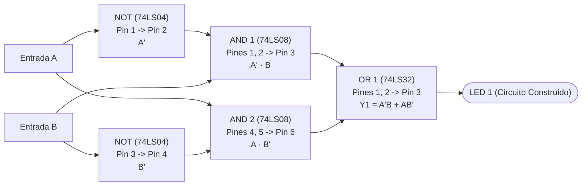

# Punto 5: Construcción de una Compuerta OR Exclusiva (XOR) y Comparación con el CI 74LS86

## 1. Enunciado
Con la tabla de verdad de una compuerta OR exclusiva construir el circuito que la representa y comparar el resultado con el funcionamiento de una compuerta XOR **74LS86**, simular los circuitos con **Quartus II** y utilizar diodos LEDs para mostrar el resultado.

---

## 2. Tabla de Verdad de la Compuerta OR Exclusiva (XOR)
La compuerta **XOR** (*Exclusive OR*) de dos entradas $A$ y $B$ entrega un `1` lógico en su salida únicamente cuando sus dos entradas tienen niveles lógicos diferentes entre sí:

| Minitérmino | Entrada $A$ | Entrada $B$ | Salida $Y = A \oplus B$ | Estado del LED |
| :---: | :---: | :---: | :---: | :---: |
| $m_0$ | **0** | **0** | **0** | Apagado |
| $m_1$ | **0** | **1** | **1** | Encendido |
| $m_2$ | **1** | **0** | **1** | Encendido |
| $m_3$ | **1** | **1** | **0** | Apagado |

---

## 3. Obtención de las Ecuaciones Booleanas

### 3.1. Forma en Suma de Productos (SOP — Minitérminos $m_1$ y $m_2$)
Tomando las filas donde $Y = 1$:
$$\mathbf{Y = \overline{A} \cdot B + A \cdot \overline{B} = A \oplus B}$$

### 3.2. Forma en Producto de Sumas (POS — Maxitérminos $M_0$ y $M_3$)
Tomando las filas donde $Y = 0$:
$$Y = (A + B) \cdot (\overline{A} + \overline{B}) = (A + B) \cdot \overline{(A \cdot B)}$$

### 3.3. Forma Equivalente solo con Compuertas NAND (1 solo CI 74LS00)
Partiendo de $Y = \overline{A}B + A\overline{B}$, sumando $A\overline{A} = 0$ y $B\overline{B} = 0$ y aplicando las Leyes de De Morgan:
$$Y = A(\overline{A} + \overline{B}) + B(\overline{A} + \overline{B}) = A \cdot \overline{(AB)} + B \cdot \overline{(AB)}$$
$$\mathbf{Y = \overline{ \overline{\left(A \cdot \overline{(A \cdot B)}\right)} \cdot \overline{\left(B \cdot \overline{(A \cdot B)}\right)} }}$$

---

## 4. Diseño de los Circuitos a Comparar

### Circuito 1A: Construcción con Compuertas Básicas (AND, OR, NOT)
Implementa directamente la ecuación canónica $Y_1 = \overline{A}B + A\overline{B}$:
* **1x CI 74LS04 (NOT):** Obtiene $\overline{A}$ y $\overline{B}$ (usa 2 de sus 6 inversores).
* **1x CI 74LS08 (AND):** Obtiene los productos $\overline{A}\cdot B$ y $A\cdot \overline{B}$ (usa 2 de sus 4 compuertas AND).
* **1x CI 74LS32 (OR):** Suma ambos productos $(\overline{A}B) + (A\overline{B})$ (usa 1 de sus 4 compuertas OR).



### Circuito 1B (Alternativa): Construcción con 4 Compuertas NAND (1x CI 74LS00)
Permite armar la compuerta XOR usando **un único circuito integrado 74LS00**:
* **NAND 1 (Pines 1, 2 $\rightarrow$ Pin 3):** $S_1 = \overline{A \cdot B}$
* **NAND 2 (Pines 4, 5 $\rightarrow$ Pin 6):** $S_2 = \overline{A \cdot S_1} = \overline{A \cdot \overline{AB}}$
* **NAND 3 (Pines 9, 10 $\rightarrow$ Pin 8):** $S_3 = \overline{B \cdot S_1} = \overline{B \cdot \overline{AB}}$
* **NAND 4 (Pines 12, 13 $\rightarrow$ Pin 11):** $Y_1 = \overline{S_2 \cdot S_3} = A \oplus B$

### Circuito 2: Compuerta XOR Integrada (CI 74LS86)
El circuito integrado **74LS86** contiene 4 compuertas XOR de 2 entradas listas para usar:
* **Pin 1:** Entrada $A$
* **Pin 2:** Entrada $B$
* **Pin 3:** Salida $Y_2 = A \oplus B \rightarrow$ **LED 2**
* **Pin 14:** $V_{CC}$ ($+5\text{ V}$), **Pin 7:** $\text{GND}$ ($0\text{ V}$).

---

## 5. Tabla Comparativa (Circuito Construido vs. CI 74LS86)

| Parámetro | Circuito Construido (74LS04 + 74LS08 + 74LS32) | Circuito Construido (Solo 74LS00) | Compuerta Nativa (74LS86) |
| :--- | :---: | :---: | :---: |
| **Función lógica resultante** | $Y_1 = \overline{A}B + A\overline{B}$ | $Y_1 = \overline{\overline{A\overline{AB}}\cdot\overline{B\overline{AB}}}$ | $Y_2 = A \oplus B$ |
| **Cantidad de CIs requeridos** | 3 integrados | 1 integrado | 1 integrado (usa solo 1/4 del chip) |
| **Niveles lógicos de retardo** | 3 niveles (NOT $\rightarrow$ AND $\rightarrow$ OR) | 3 niveles NAND | 1 compuerta integrada (~2 niveles internos) |
| **Retardo de propagación típico ($t_{pd}$)** | $\approx 27\text{ ns}$ ($9 + 9 + 9\text{ ns}$) | $\approx 27\text{ ns}$ ($3 \times 9\text{ ns}$) | $\approx 10\text{ ns}$ (típico hoja de datos) |
| **Complejidad de cableado** | Alta (9 puentes de señal) | Media (6 puentes de señal) | Mínima (2 entradas, 1 salida) |

> [!IMPORTANT]
> **Conclusión para el informe IEEE:** En estado estacionario (DC / pruebas con interruptores y LEDs), ambos circuitos presentan **exactamente la misma tabla de verdad**. En régimen dinámico (alta frecuencia en simulación temporal de Quartus II), el circuito discreto presenta un mayor retardo de propagación y posibles *glitches* (riesgos estáticos/dinámicos) debido a la asimetría del retardo de los inversores frente a las señales directas, mientras que el **74LS86** optimiza internamente la ruta crítica en un solo encapsulado.

---

## 6. Código VHDL para Simulación Comparativa en Quartus II

```vhdl
library IEEE;
use IEEE.STD_LOGIC_1164.ALL;

entity punto5_xor_comparacion is
    Port (
        A            : in  STD_LOGIC;
        B            : in  STD_LOGIC;
        Y_construida : out STD_LOGIC; -- LED 1: Circuito con compuertas básicas
        Y_74LS86     : out STD_LOGIC  -- LED 2: Compuerta XOR nativa
    );
end punto5_xor_comparacion;

architecture Behavioral of punto5_xor_comparacion is
begin
    -- 1. Circuito construido a partir de la tabla de verdad (SOP):
    Y_construida <= ((not A) and B) or (A and (not B));

    -- 2. Compuerta XOR 74LS86:
    Y_74LS86     <= A xor B;
end Behavioral;
```

---

## 7. Acondicionamiento de Corriente para los LEDs
* **Entradas $A, B$:** Dos interruptores del DIP switch a $+5\text{ V}$ con resistencias *pull-down* de $1\text{ k}\Omega$ a $\text{GND}$ (las entradas $A$ y $B$ alimentan en paralelo tanto al circuito construido como a los pines 1 y 2 del `74LS86`).
* **Salidas $Y_1$ y $Y_2$:** Cada salida se conecta mediante una resistencia de base de $2.2\text{ k}\Omega$ a un transistor NPN **2N2222** (con emisor a $\text{GND}$) cuyo colector enciende el LED respectivo con su resistencia limitadora de $220\ \Omega$ a $+5\text{ V}$.
