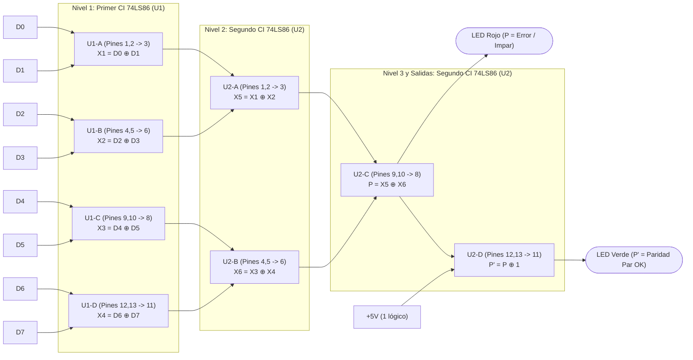

# Punto 6: Diseño de un Verificador de Paridad Par para una Palabra de 8 Bits

## 1. Enunciado
Diseñar un verificador de paridad par para una palabra de 8 bits. Simular los circuitos con **Quartus II** y utilizar diodos LEDs para mostrar el resultado.

---

## 2. Fundamento Teórico (Paridad Par en 8 Bits)
Sea una palabra binaria de 8 bits:
$$D = (D_7, D_6, D_5, D_4, D_3, D_2, D_1, D_0)$$

Una palabra cumple con **paridad par** cuando la cantidad total de bits en estado `1` dentro de la palabra es un **número par** ($0, 2, 4, 6\text{ u }8$ unos).

La operación lógica que evalúa la paridad de un conjunto de bits es la suma módulo-2 (**XOR** en cascada):
$$P = D_7 \oplus D_6 \oplus D_5 \oplus D_4 \oplus D_3 \oplus D_2 \oplus D_1 \oplus D_0$$

### Comportamiento de las Salidas:
1. **Salida $P$ (Bit de Paridad Par / Indicador de Error de Paridad Par):**
   * **$P = 0$:** La cantidad de `1`s en los 8 bits es **PAR** $\rightarrow$ **Palabra correcta (cumple paridad par)**.
   * **$P = 1$:** La cantidad de `1`s en los 8 bits es **IMPAR** $\rightarrow$ **Error detectado (no cumple paridad par)** *(o bien indica que debe agregarse un `1` como bit de paridad par si actúa como generador)*.
2. **Salida $\overline{P}$ (Indicador de "Paridad Par Correcta" activo en alto):**
   * $$\overline{P} = \overline{D_7 \oplus D_6 \oplus D_5 \oplus D_4 \oplus D_3 \oplus D_2 \oplus D_1 \oplus D_0}$$
   * **$\overline{P} = 1$:** La palabra tiene **cantidad PAR de `1`s** (LED Verde = Paridad Par OK).
   * **$\overline{P} = 0$:** La palabra tiene **cantidad IMPAR de `1`s** (LED Rojo en $P$ = Error / Impar).

---

## 3. Tabla de Verdad Resumida (por Cantidad de Unos y Ejemplos)

Dado que 8 bits tienen $2^8 = 256$ combinaciones, el funcionamiento depende exclusivamente del peso de Hamming (cantidad de bits en `1`):

| Cantidad de `1`s en $(D_7 \dots D_0)$ | ¿Es Par? | Ejemplo de Palabra $(D_7 D_6 D_5 D_4 D_3 D_2 D_1 D_0)$ | Salida XOR ($P$)<br>*(LED Rojo: Error / Impar)* | Salida XNOR ($\overline{P}$)<br>*(LED Verde: Paridad Par OK)* |
| :---: | :---: | :---: | :---: | :---: |
| **0 unos** | Sí (Par) | `0000 0000` | **0** | **1** |
| **1 uno** | No (Impar) | `0000 0001` | **1** | **0** |
| **2 unos** | Sí (Par) | `0000 0011` | **0** | **1** |
| **3 unos** | No (Impar) | `0000 0111` | **1** | **0** |
| **4 unos** | Sí (Par) | `0000 1111` | **0** | **1** |
| **5 unos** | No (Impar) | `0001 1111` | **1** | **0** |
| **6 unos** | Sí (Par) | `0011 1111` | **0** | **1** |
| **7 unos** | No (Impar) | `0111 1111` | **1** | **0** |
| **8 unos** | Sí (Par) | `1111 1111` | **0** | **1** |

---

## 4. Diseño del Circuito mediante Árbol Balanceado de Compuertas XOR (2x CI 74LS86)

Usando la propiedad asociativa de la operación XOR, podemos agrupar los 8 bits en un **árbol binario de 3 niveles** que utiliza **$8 - 1 = 7$ compuertas XOR de 2 entradas**:

$$P = \big((D_0 \oplus D_1) \oplus (D_2 \oplus D_3)\big) \oplus \big((D_4 \oplus D_5) \oplus (D_6 \oplus D_7)\big)$$

Además, como dos circuitos integrados **74LS86** disponen en total de **8 compuertas XOR**, la **8.ª compuerta XOR sobrante** se configura como inversor conectando una de sus entradas a $+5\text{ V}$ (`1` lógico), ya que:
$$\overline{P} = P \oplus 1$$

De esta forma, con **únicamente 2 circuitos integrados `74LS86`** (sin necesitar ningún `74LS04`) se obtienen simultáneamente ambas salidas: **$P$ (Error / Impar)** y **$\overline{P}$ (Paridad Par OK)**.

### Diagrama Esquemático del Árbol de Paridad



---

## 5. Tabla de Pines para el Montaje en Protoboard

| Integrado | Compuerta | Pines de Entrada | Pin de Salida | Señal Calculada |
| :--- | :--- | :---: | :---: | :--- |
| **U1 (74LS86 #1)** | XOR 1 | Pin 1 ($D_0$), Pin 2 ($D_1$) | **Pin 3** | $X_1 = D_0 \oplus D_1$ |
| **U1 (74LS86 #1)** | XOR 2 | Pin 4 ($D_2$), Pin 5 ($D_3$) | **Pin 6** | $X_2 = D_2 \oplus D_3$ |
| **U1 (74LS86 #1)** | XOR 3 | Pin 9 ($D_4$), Pin 10 ($D_5$) | **Pin 8** | $X_3 = D_4 \oplus D_5$ |
| **U1 (74LS86 #1)** | XOR 4 | Pin 12 ($D_6$), Pin 13 ($D_7$) | **Pin 11** | $X_4 = D_6 \oplus D_7$ |
| **U2 (74LS86 #2)** | XOR 1 | Pin 1 ($\text{Pin 3 de U1}$), Pin 2 ($\text{Pin 6 de U1}$) | **Pin 3** | $X_5 = D_0 \oplus D_1 \oplus D_2 \oplus D_3$ |
| **U2 (74LS86 #2)** | XOR 2 | Pin 4 ($\text{Pin 8 de U1}$), Pin 5 ($\text{Pin 11 de U1}$) | **Pin 6** | $X_6 = D_4 \oplus D_5 \oplus D_6 \oplus D_7$ |
| **U2 (74LS86 #2)** | XOR 3 | Pin 9 ($\text{Pin 3 de U2}$), Pin 10 ($\text{Pin 6 de U2}$) | **Pin 8** | **Salida $P$ (Impar / Error Par)** |
| **U2 (74LS86 #2)** | XOR 4 | Pin 12 ($\text{Pin 8 de U2}$), Pin 13 ($+5\text{ V}$) | **Pin 11** | **Salida $\overline{P}$ (Paridad Par OK)** |

*(En ambos integrados `U1` y `U2`: **Pin 14** a $+5\text{ V}$ y **Pin 7** a $\text{GND}$. Alternativa MSI: el integrado **74LS280** realiza esta misma función en un solo chip de 14 pines).*

---

## 6. Código VHDL para Simulación en Quartus II

```vhdl
library IEEE;
use IEEE.STD_LOGIC_1164.ALL;

entity punto6_paridad_8bits is
    Port (
        D          : in  STD_LOGIC_VECTOR(7 downto 0); -- Palabra de 8 bits (D7..D0)
        P_error    : out STD_LOGIC; -- '1' si hay número impar de 1s (Error de paridad par)
        Paridad_OK : out STD_LOGIC  -- '1' si hay número par de 1s (Paridad par válida)
    );
end punto6_paridad_8bits;

architecture Behavioral of punto6_paridad_8bits is
    signal p_xor : STD_LOGIC;
begin
    -- Árbol XOR de los 8 bits:
    p_xor <= ((D(0) xor D(1)) xor (D(2) xor D(3))) xor
             ((D(4) xor D(5)) xor (D(6) xor D(7)));

    P_error    <= p_xor;
    Paridad_OK <= not p_xor;
end Behavioral;
```

---

## 7. Acondicionamiento Físico
1. **Palabra de 8 bits ($D_7 \dots D_0$):** Utilizar un **DIP switch de 8 posiciones** conectado a $+5\text{ V}$ y un arreglo de 8 resistencias *pull-down* de $1\text{ k}\Omega$ a $2.2\text{ k}\Omega$ a $\text{GND}$ (y opcionalmente 8 LEDs testigos en las entradas con sus drivers para visualizar la palabra ingresada).
2. **Salidas ($P$ y $\overline{P}$):** Desde el **Pin 8** y el **Pin 11** de `U2` (`74LS86`), salir a través de resistencias de base de $2.2\text{ k}\Omega$ hacia dos transistores NPN **2N2222** que conmutan el **LED Rojo** ($P$) y el **LED Verde** ($\overline{P}$) con resistencias limitadoras de $220\ \Omega$ a $+5\text{ V}$.
