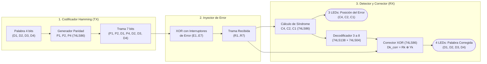

# Punto 7: Código Hamming (7,4) de Detección y Corrección de Errores para Palabras de 4 Bits

## 1. Enunciado
Implementar el código Hamming de corrección de errores para palabras de 4 bits generando un error en cualquiera de los bits de la palabra. Simular los circuitos con **Quartus II** y utilizar diodos LEDs para mostrar el resultado.

---

## 2. Fundamento Matemático del Código Hamming (7,4)

Para transmitir una palabra de datos de **$m = 4\text{ bits}$** ($D_1, D_2, D_3, D_4$) con capacidad de **detectar y corregir automáticamente cualquier error de 1 bit**, la cantidad de bits de paridad $p$ debe cumplir la relación de Hamming:
$$2^p \ge m + p + 1$$
Para $m = 4$:
$$2^3 = 8 \ge 4 + 3 + 1 = 8 \implies \mathbf{p = 3\text{ bits de paridad } (P_1, P_2, P_4)}$$

La trama codificada resultante tiene **$n = m + p = 7\text{ bits}$**, ubicando los bits de paridad en las posiciones que son potencias de 2 ($1, 2, 4$) y los bits de datos en las posiciones restantes ($3, 5, 6, 7$):

| Posición decimal ($k$) | **1** | **2** | **3** | **4** | **5** | **6** | **7** |
| :--- | :---: | :---: | :---: | :---: | :---: | :---: | :---: |
| **Posición en binario ($k_2$)** | `001` | `010` | `011` | `100` | `101` | `110` | `111` |
| **Bit de la trama ($T_k$)** | **$P_1$** | **$P_2$** | **$D_1$** | **$P_4$** | **$D_2$** | **$D_3$** | **$D_4$** |
| **Cubierto por $P_1$ ($k_2$ termina en `..1`)** | $\checkmark$ | · | $\checkmark$ | · | $\checkmark$ | · | $\checkmark$ |
| **Cubierto por $P_2$ ($k_2$ tiene `1` central)** | · | $\checkmark$ | $\checkmark$ | · | · | $\checkmark$ | $\checkmark$ |
| **Cubierto por $P_4$ ($k_2$ inicia en `1..`)** | · | · | · | $\checkmark$ | $\checkmark$ | $\checkmark$ | $\checkmark$ |

---

## 3. Ecuaciones de Diseño por Etapas

### 3.1. Etapa 1: Codificador / Generador de Bits de Paridad (Criterio de Paridad Par)
Cada bit de paridad se calcula mediante la operación XOR de los bits de datos que supervisa:
* **Bit de paridad $P_1$ (posiciones 1, 3, 5, 7):**
  $$\mathbf{P_1 = D_1 \oplus D_2 \oplus D_4}$$
* **Bit de paridad $P_2$ (posiciones 2, 3, 6, 7):**
  $$\mathbf{P_2 = D_1 \oplus D_3 \oplus D_4}$$
* **Bit de paridad $P_4$ (posiciones 4, 5, 6, 7):**
  $$\mathbf{P_4 = D_2 \oplus D_3 \oplus D_4}$$

> [!TIP]
> **Optimización de compuertas XOR en el transmisor:**
> En lugar de usar 6 compuertas XOR para calcular $P_1, P_2, P_4$, basta calcular primero $X_A = D_1 \oplus D_4$ y $X_B = D_2 \oplus D_4$ (2 compuertas XOR), con lo cual:
> * $P_1 = X_A \oplus D_2$
> * $P_2 = X_A \oplus D_3$
> * $P_4 = X_B \oplus D_3$
> ¡Solo se requieren **5 compuertas XOR** en total para el transmisor!

---

### 3.2. Tabla de Verdad del Codificador Hamming (7,4)

| Decimal | Datos $(D_1 D_2 D_3 D_4)$ | Paridades $(P_1 P_2 P_4)$ | Trama Hamming de 7 bits $(P_1 P_2 D_1 P_4 D_2 D_3 D_4)$ |
| :---: | :---: | :---: | :---: |
| **0** | `0000` | `000` | `0 0 0 0 0 0 0` |
| **1** | `0001` | `111` | `1 1 0 1 0 0 1` |
| **2** | `0010` | `011` | `0 1 0 1 0 1 0` |
| **3** | `0011` | `100` | `1 0 0 0 0 1 1` |
| **4** | `0100` | `101` | `1 0 0 1 1 0 0` |
| **5** | `0101` | `010` | `0 1 0 0 1 0 1` |
| **6** | `0110` | `110` | `1 1 0 0 1 1 0` |
| **7** | `0111` | `001` | `0 0 0 1 1 1 1` |
| **8** | `1000` | `110` | `1 1 1 0 0 0 0` |
| **9** | `1001` | `001` | `0 0 1 1 0 0 1` |
| **10** | `1010` | `101` | `1 0 1 1 0 1 0` |
| **11** | `1011` | `010` | `0 1 1 0 0 1 1` |
| **12** | `1100` | `011` | `0 1 1 1 1 0 0` |
| **13** | `1101` | `100` | `1 0 1 0 1 0 1` |
| **14** | `1110` | `000` | `0 0 1 0 1 1 0` |
| **15** | `1111` | `111` | `1 1 1 1 1 1 1` |

---

### 3.3. Etapa 2: Generador / Inyector de Error en Cualquier Bit
Para provocar un error controlado en cualquiera de los bits de la palabra (mediante interruptores de error $E_k \in \{0,1\}$), cada bit se hace pasar por una compuerta XOR (**74LS86**):
$$R_k = T_k \oplus E_k$$
* Si $E_k = 0 \implies R_k = T_k$ (el bit pasa intacto).
* Si $E_k = 1 \implies R_k = \overline{T_k}$ (el bit se invierte, simulando un error en la posición $k$).

*(En el protoboard también se puede implementar el inyector de error de forma aún más sencilla mediante un selector/interruptor SPDT en cada línea o invirtiendo cualquiera de los 4 bits de datos $D_1, D_2, D_3, D_4$ después del generador de paridad).*

---

### 3.4. Etapa 3: Detector de Síndrome de Error ($C_4, C_2, C_1$) en el Receptor
Sea la trama recibida (posiblemente con un bit alterado):
$$R = (R_1, R_2, R_3, R_4, R_5, R_6, R_7) = (\hat{P}_1, \hat{P}_2, \hat{D}_1, \hat{P}_4, \hat{D}_2, \hat{D}_3, \hat{D}_4)$$

El receptor calcula los **3 bits de síndrome ($C_1, C_2, C_4$)**:
$$\mathbf{C_1 = R_1 \oplus R_3 \oplus R_5 \oplus R_7}$$
$$\mathbf{C_2 = R_2 \oplus R_3 \oplus R_6 \oplus R_7}$$
$$\mathbf{C_4 = R_4 \oplus R_5 \oplus R_6 \oplus R_7}$$

El número binario **$S = (C_4 C_2 C_1)_2$** apunta directamente a la **posición exacta ($1$ a $7$) del bit que sufrió el error**:

| Síndrome $(C_4 C_2 C_1)$ | Valor Decimal | Diagnóstico del Receptor | Acción del Corrector |
| :---: | :---: | :--- | :--- |
| **`000`** | **0** | **Sin error** (Trama íntegra) | Ninguna ($D_{\text{corr}} = \hat{D}$) |
| **`001`** | **1** | Error en posición 1 ($R_1 = \hat{P}_1$) | Datos intactos (falló $P_1$) |
| **`010`** | **2** | Error en posición 2 ($R_2 = \hat{P}_2$) | Datos intactos (falló $P_2$) |
| **`011`** | **3** | **Error en posición 3 ($R_3 = \hat{D}_1$)** | Invertir $R_3 \rightarrow D_{1\text{corr}} = \overline{R_3}$ |
| **`100`** | **4** | Error en posición 4 ($R_4 = \hat{P}_4$) | Datos intactos (falló $P_4$) |
| **`101`** | **5** | **Error en posición 5 ($R_5 = \hat{D}_2$)** | Invertir $R_5 \rightarrow D_{2\text{corr}} = \overline{R_5}$ |
| **`110`** | **6** | **Error en posición 6 ($R_6 = \hat{D}_3$)** | Invertir $R_6 \rightarrow D_{3\text{corr}} = \overline{R_6}$ |
| **`111`** | **7** | **Error en posición 7 ($R_7 = \hat{D}_4$)** | Invertir $R_7 \rightarrow D_{4\text{corr}} = \overline{R_7}$ |

---

### 3.5. Etapa 4: Corrección Automática del Bit Erróneo (74LS138 + 74LS04 + 74LS86)
Para recuperar automáticamente los 4 bits de datos originales $(D_{1\text{corr}}, D_{2\text{corr}}, D_{3\text{corr}}, D_{4\text{corr}})$:
1. Se conectan los bits del síndrome $(C_4, C_2, C_1)$ a las entradas de selección $(A_2, A_1, A_0)$ de un **decodificador de 3 a 8 (`74LS138`)** habilitado ($G_1 = 1, \overline{G_{2A}} = 0, \overline{G_{2B}} = 0$).
2. Como las salidas del `74LS138` ($\overline{Y_0} \dots \overline{Y_7}$) son activas en bajo (`0` cuando se selecciona esa posición), se invierten las 4 salidas correspondientes a las posiciones de datos ($\overline{Y_3}, \overline{Y_5}, \overline{Y_6}, \overline{Y_7}$) usando 4 inversores de un **74LS04** para obtener $Y_3, Y_5, Y_6, Y_7$ activas en alto.
3. Finalmente, cada señal $Y_k$ entra junto con el bit de dato recibido $R_k$ a una compuerta XOR de un **74LS86**:
   $$\mathbf{D_{1\text{corr}} = R_3 \oplus Y_3}$$
   $$\mathbf{D_{2\text{corr}} = R_5 \oplus Y_5}$$
   $$\mathbf{D_{3\text{corr}} = R_6 \oplus Y_6}$$
   $$\mathbf{D_{4\text{corr}} = R_7 \oplus Y_7}$$
   Cuando hay error en la posición $k$, $Y_k = 1$ y la compuerta XOR invierte $R_k$ ($R_k \oplus 1 = \overline{R_k} = D_{\text{original}}$), **corrigiendo el error de forma automática**.

---

## 4. Diagrama de Bloques del Sistema Completo



---

## 5. Lista de Materiales Optimizada para el Montaje en Protoboard
Si el error se inyecta sobre cualquiera de los 4 bits de datos $(D_1, D_2, D_3, D_4)$ mediante un DIP switch de 4 posiciones:
* **5x CI 74LS86** (20 compuertas XOR disponibles; el sistema completo usa: 5 XOR para el transmisor, 4 XOR para inyectar error en los 4 bits de datos, 7 XOR para el síndrome y 4 XOR para la etapa correctora = **20 compuertas XOR exactas**).
* **1x CI 74LS138** (Decodificador de 3 a 8 para ubicar el bit erróneo a partir de $C_4, C_2, C_1$).
* **1x CI 74LS04** (Usa 4 de sus 6 inversores para pasar a activo en alto las salidas $\overline{Y_3}, \overline{Y_5}, \overline{Y_6}, \overline{Y_7}$ del `74LS138`).
* **7 LEDs con sus etapas driver (ULN2003A o 7x 2N2222):**
  * **3 LEDs Rojos/Amarillos** para mostrar en binario la posición del error detectado: síndrome $(C_4, C_2, C_1)$.
  * **4 LEDs Verdes** para mostrar la palabra de 4 bits ya corregida: $(D_{1\text{corr}}, D_{2\text{corr}}, D_{3\text{corr}}, D_{4\text{corr}})$.

---

## 6. Código VHDL Completo para Simulación en Quartus II

Este código implementa el transmisor Hamming (7,4), la inyección de error en cualquiera de los 7 bits, el cálculo del síndrome y la corrección automática de los 4 bits de datos:

```vhdl
library IEEE;
use IEEE.STD_LOGIC_1164.ALL;

entity punto7_hamming74 is
    Port (
        -- Palabra de 4 bits de entrada (D1, D2, D3, D4)
        D_in     : in  STD_LOGIC_VECTOR(1 to 4);
        -- Vector de inyección de error en cualquiera de los 7 bits (posiciones 1 a 7)
        Error_in : in  STD_LOGIC_VECTOR(1 to 7);
        -- Salida de la trama transmitida (sin error)
        T_out    : out STD_LOGIC_VECTOR(1 to 7);
        -- Salida del Síndrome (C4, C2, C1) -> Indica la posición (1..7) del bit con error
        Sindrome : out STD_LOGIC_VECTOR(2 downto 0);
        -- Palabra de 4 bits corregida automáticamente a la salida
        D_corr   : out STD_LOGIC_VECTOR(1 to 4)
    );
end punto7_hamming74;

architecture Behavioral of punto7_hamming74 is
    signal P1, P2, P4 : STD_LOGIC;
    signal T          : STD_LOGIC_VECTOR(1 to 7); -- Trama transmitida
    signal R          : STD_LOGIC_VECTOR(1 to 7); -- Trama recibida con error
    signal C1, C2, C4 : STD_LOGIC;
    signal sind_vec   : STD_LOGIC_VECTOR(2 downto 0);
    signal R_corr     : STD_LOGIC_VECTOR(1 to 7);
begin
    -- 1. Generación de bits de paridad par (Transmisor):
    P1 <= D_in(1) xor D_in(2) xor D_in(4);
    P2 <= D_in(1) xor D_in(3) xor D_in(4);
    P4 <= D_in(2) xor D_in(3) xor D_in(4);

    -- Construcción de la trama Hamming (posiciones 1 a 7):
    T(1) <= P1;
    T(2) <= P2;
    T(3) <= D_in(1);
    T(4) <= P4;
    T(5) <= D_in(2);
    T(6) <= D_in(3);
    T(7) <= D_in(4);

    T_out <= T;

    -- 2. Inyección de error en el canal (XOR bit a bit):
    R <= T xor Error_in;

    -- 3. Cálculo del síndrome de error en el receptor:
    C1 <= R(1) xor R(3) xor R(5) xor R(7);
    C2 <= R(2) xor R(3) xor R(6) xor R(7);
    C4 <= R(4) xor R(5) xor R(6) xor R(7);

    sind_vec <= C4 & C2 & C1;
    Sindrome <= sind_vec;

    -- 4. Decodificación del síndrome y corrección automática del bit dañado:
    R_corr(1) <= not R(1) when sind_vec = "001" else R(1);
    R_corr(2) <= not R(2) when sind_vec = "010" else R(2);
    R_corr(3) <= not R(3) when sind_vec = "011" else R(3); -- Corrige D1
    R_corr(4) <= not R(4) when sind_vec = "100" else R(4);
    R_corr(5) <= not R(5) when sind_vec = "101" else R(5); -- Corrige D2
    R_corr(6) <= not R(6) when sind_vec = "110" else R(6); -- Corrige D3
    R_corr(7) <= not R(7) when sind_vec = "111" else R(7); -- Corrige D4

    -- Extracción de los 4 bits de datos ya corregidos:
    D_corr(1) <= R_corr(3);
    D_corr(2) <= R_corr(5);
    D_corr(3) <= R_corr(6);
    D_corr(4) <= R_corr(7);
end Behavioral;
```
